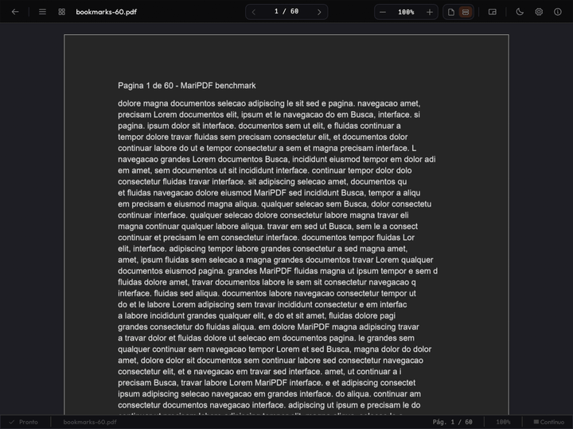
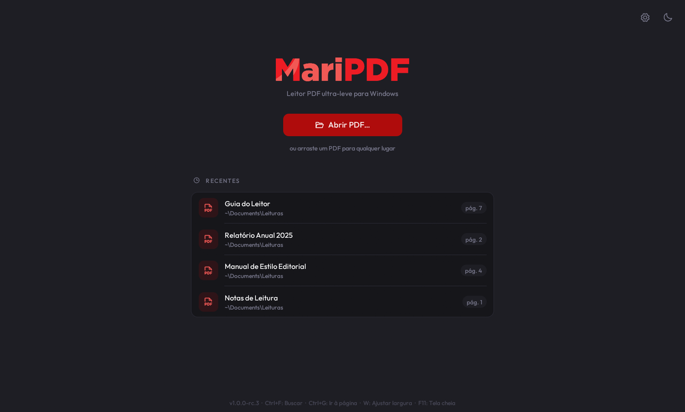
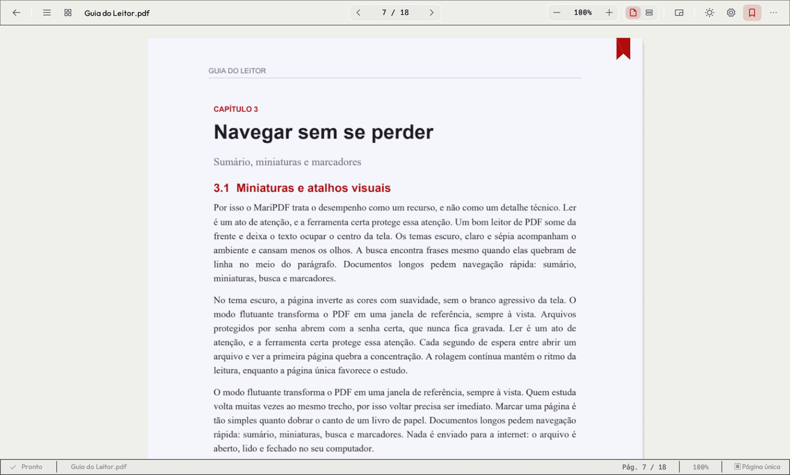
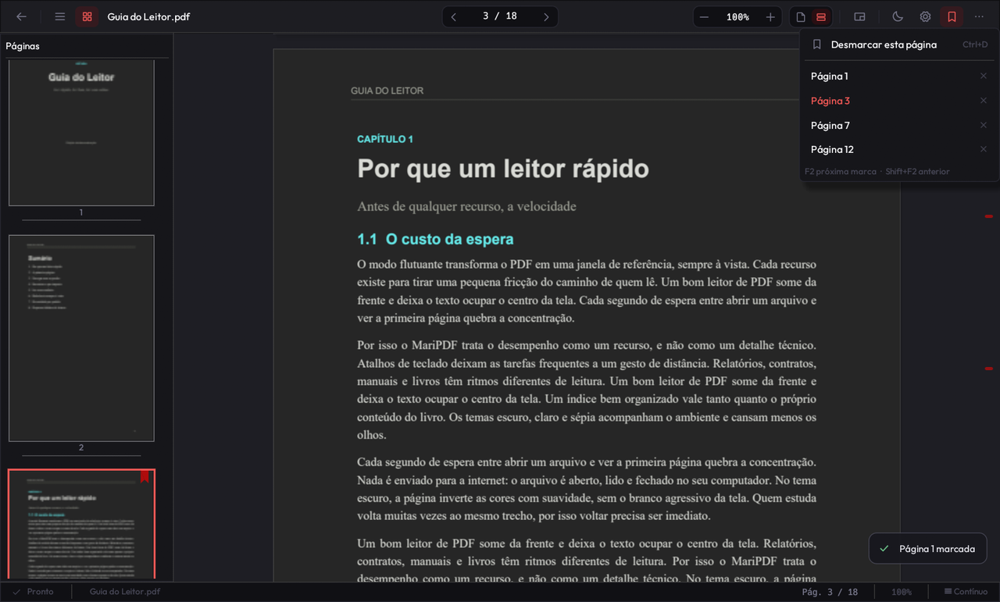
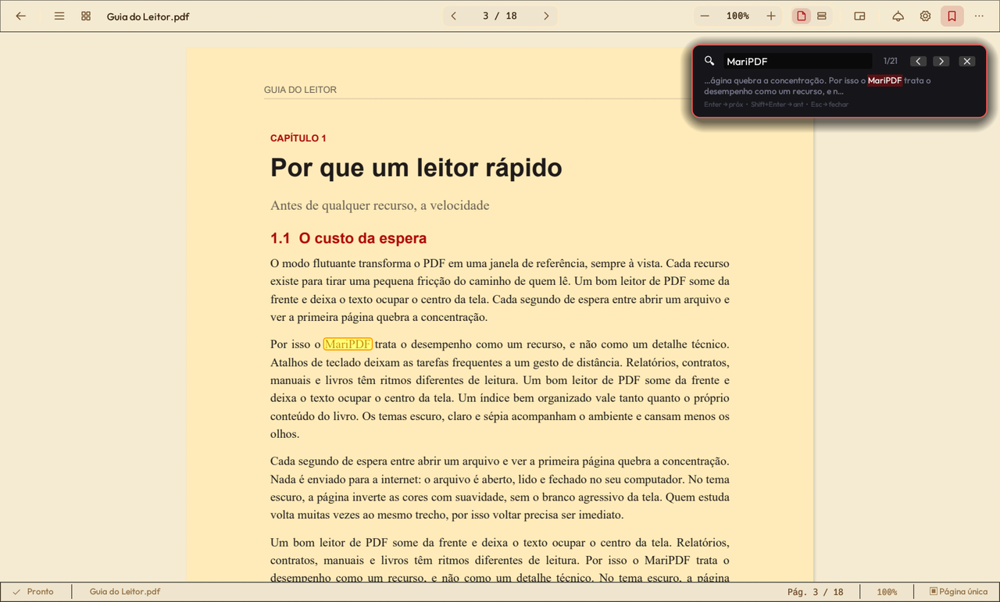
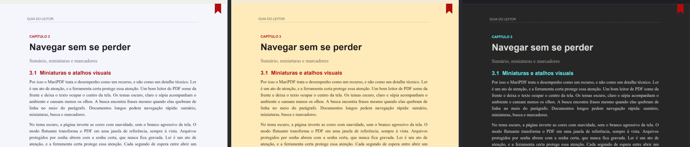
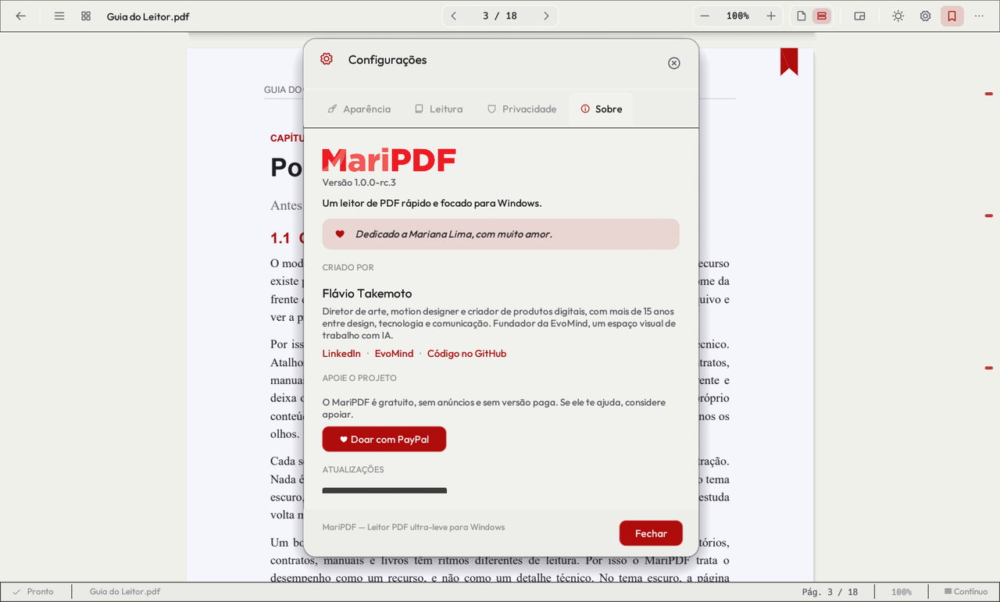
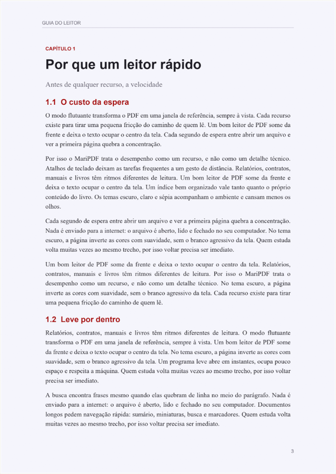

<div align="center">


### Um leitor de PDF rápido, leve e bonito para Windows.

*Abrir. Ler. Pronto.*

[](https://github.com/flavioflavioflavio/MariPDF/releases)
[](LICENSE)
[](https://github.com/flavioflavioflavio/MariPDF/releases)
[](https://www.rust-lang.org/)

**[⬇ Baixar](https://github.com/flavioflavioflavio/MariPDF/releases/latest)** ·
[Recursos](#recursos) ·
[Atalhos](#atalhos) ·
[Desempenho](#desempenho) ·
[Compilar](#compilar-do-código-fonte) ·
[Apoiar](#apoie-o-maripdf)



</div>

---

O MariPDF abre um PDF em poucos milissegundos e sai da frente para você ler.
Não tem conta, anúncio, telemetria nem versão paga: é um executável de ~22 MB
que roda até de um pendrive, com o motor PDFium do Chromium embutido.

<table>
<tr>
<td width="50%"></td>
<td width="50%"></td>
</tr>
<tr>
<td align="center"><sub>Tela inicial: arraste um PDF ou volte de onde parou</sub></td>
<td align="center"><sub>Leitor: a página no centro, a interface discreta</sub></td>
</tr>
</table>

## Por que o MariPDF

- **Rápido de verdade.** Abre um PDF em 7–10 ms e mostra a primeira página em
  menos de 100 ms. Todo o trabalho pesado roda fora da interface, que nunca trava.
- **Leve.** Um único arquivo de ~22 MB, sem dependências. A memória fica
  estável em sessões longas (medida em teste de 20 minutos).
- **Privado.** Nada sai do seu computador. A rede só é usada quando você clica
  em *Verificar atualizações*.
- **Feito para ler.** Sem barra de ferramentas lotada, sem edição de PDF: só o
  que ajuda a ler, navegar e voltar.
- **Livre.** Código aberto (GPLv3), gratuito para sempre e mantido por doações.

## Recursos

### Leitura

- **Página única** ou **rolagem contínua** virtualizada: documentos de 1.000
  páginas abrem sem esforço.
- **Zoom** com 100% = tamanho físico, ajustar à largura (`W`) ou à página (`Ctrl+0`).
- **Girar a página** (`Ctrl+R` / `Ctrl+Shift+R`), guardado por documento.
- **Recarrega sozinho** quando o PDF muda no disco, mantendo a página e o zoom.
  Ótimo para quem gera PDF com LaTeX ou exporta de outro programa.
- **PDF com senha**: o app pede a senha, que fica só na memória.

### Navegação

- **Sumário** do próprio PDF (ou gerado automaticamente) e **miniaturas**.
- **Marcadores**: uma fita no canto da página marca e desmarca com um clique.
  `F2` / `Shift+F2` saltam entre as marcas, e um trilho na lateral mostra onde
  elas estão no documento.
- **Voltar e avançar** (`Alt+←` / `Alt+→` ou os botões laterais do mouse)
  depois de seguir um link, o sumário ou a busca.
- **Links** internos e externos clicáveis.

<table>
<tr>
<td width="50%"></td>
<td width="50%"></td>
</tr>
<tr>
<td align="center"><sub>Marcadores na página, nas miniaturas e no trilho lateral</sub></td>
<td align="center"><sub>Busca com destaque na página e trecho de contexto</sub></td>
</tr>
</table>

### Busca e texto

- **Busca** (`Ctrl+F`) que ignora maiúsculas e minúsculas, encontra frases
  que quebram de linha e mostra o trecho de contexto de cada ocorrência.
- **Seleção de texto** com arrastar, duplo e triplo clique, `Shift`+clique e
  `Ctrl+A`. `Ctrl+C` copia.
- **Copiar a página como imagem** (`Ctrl+Shift+C`), pronta para colar.

### Conforto

- Temas **escuro**, **claro** e **sépia**, ou seguindo o Windows. Cada tema tem
  páginas que combinam com ele: *Noturno*, *Preto profundo*, *Livro novo*,
  *Preto e branco*, *Papel antigo* e outras.
- **Modo Flutuante** (`Ctrl+Shift+F`): o PDF vira a própria janela, sem bordas,
  e pode ficar sempre no topo. Ideal como referência ao lado de outro programa.
- Interface em **português** e **inglês**, com vários tamanhos e fontes.
- A janela reabre onde você deixou, inclusive com monitores desconectados.

<div align="center">

<br><sub>A mesma página nos temas claro, sépia e escuro</sub>
</div>

### Windows

- **Propriedades do documento** (`Alt+Enter`): tamanho, páginas, papel, autor,
  datas e versão do PDF.
- **Mostrar na pasta** abre o Explorer com o arquivo selecionado.
- Pode virar o **leitor padrão de PDF** pelo fluxo oficial do Windows 10/11.

<table>
<tr>
<td width="62%"></td>
<td width="38%" align="center"></td>
</tr>
<tr>
<td align="center"><sub>Configurações, com atualização verificada</sub></td>
<td align="center"><sub>Modo Flutuante: só a página, sem moldura</sub></td>
</tr>
</table>

## Instalação

Baixe na página de **[Releases](https://github.com/flavioflavioflavio/MariPDF/releases)**:

| Arquivo | Para quem |
|---|---|
| `MariPDF-<versão>-setup.exe` | Instalador **por usuário**: não pede administrador nem UAC, cria atalho no Menu Iniciar e pode registrar o `.pdf`. |
| `MariPDF-<versão>-portable.exe` | Um único arquivo, sem instalar. Roda de qualquer pasta ou pendrive. |

> **Aviso do SmartScreen.** Os executáveis ainda não têm assinatura de código
> da Microsoft. Na primeira execução o Windows pode mostrar *"O Windows protegeu
> o computador"*: clique em **Mais informações → Executar assim mesmo**.

Cada release traz um `SHA256SUMS.txt` assinado (Ed25519). Para conferir um
arquivo baixado:

```powershell
Get-FileHash .\MariPDF-<versão>-setup.exe -Algorithm SHA256
```

Compare o resultado com a linha correspondente do `SHA256SUMS.txt`. O botão
*Configurações → Sobre → Verificar atualizações* faz essa verificação sozinho:
a versão nova só é instalada se a assinatura e o hash conferirem.

## Atalhos

| Ação | Atalho |
|---|---|
| Abrir PDF | arrastar para a janela ou clicar em *Abrir PDF…* |
| Página anterior / próxima | `←` `→` · `PgUp` `PgDn` · roda do mouse |
| Primeira / última página | `Home` / `End` |
| Ir para página | `Ctrl+G` |
| Buscar · próxima · anterior | `Ctrl+F` · `F3` · `Shift+F3` |
| Zoom | `Ctrl` + roda · `Ctrl++` · `Ctrl+−` |
| Ajustar à largura / à página | `W` / `Ctrl+0` |
| Página única ↔ contínua | `Ctrl+Shift+M` |
| Girar à direita / esquerda | `Ctrl+R` / `Ctrl+Shift+R` |
| Voltar / avançar | `Alt+←` / `Alt+→` · botões laterais do mouse |
| Marcar página · próxima · anterior marca | `Ctrl+D` · `F2` · `Shift+F2` |
| Copiar texto / página como imagem | `Ctrl+C` / `Ctrl+Shift+C` |
| Propriedades do documento | `Alt+Enter` |
| Modo Flutuante | `Ctrl+Shift+F` |
| Tela cheia | `F11` |
| Sobre | `Ctrl+Shift+I` |

## Desempenho

Medido com o medidor embutido sobre um corpus sintético reproduzível
(Ryzen 9 5950X, RTX 3080, Windows 11). Método e números completos em
[`doc/benchmarks`](doc/benchmarks/baseline-2026-10-19.md).

| Métrica (mediana) | Resultado |
|---|---|
| Abrir um PDF | 7–10 ms |
| Abrir até a 1ª página na tela | 58–90 ms |
| Saltar para uma página sem cache | 12–74 ms |
| Página vizinha (já pré-carregada) | 5–17 ms |
| Pior frame da interface no roteiro | < 40 ms (p95 < 9 ms) |
| Memória no fim do roteiro | ~220–280 MB |
| Teste de 20 min (3.300 ações) | 0 erros, sem crescimento de memória |

## Compilar do código-fonte

Requisitos: Windows 10/11, Rust estável (MSVC) e Visual Studio Build Tools 2022.

```powershell
git clone https://github.com/flavioflavioflavio/MariPDF.git
cd MariPDF
cargo run --release
```

| Comando | Para quê |
|---|---|
| `pwsh tools/gates.ps1` | `fmt` + `clippy -D warnings` + testes, como no CI |
| `pwsh tools/smoke.ps1` | abre o app real com um PDF conhecido e exige o roteiro completo |
| `pwsh tools/bench.ps1` | mede o corpus de benchmark e gera `summary.md` |
| `pwsh tools/package.ps1` | portátil + instalador + SHA256SUMS em `dist/` (requer Inno Setup 6) |
| `pwsh tools/installer_test.ps1` | instala, atualiza, testa downgrade e desinstala |
| `python tools/make_demo_pdfs.py <pasta>` | gera os PDFs de demonstração usados nos prints |

Arquitetura, decisões e contratos estão em [`doc/`](doc/):
[arquitetura](doc/02_arquitetura.md) ·
[roadmap da v1.0](doc/08_roadmap_blazing_fast_v1.md) ·
[matriz de contratos](doc/09_matriz_contratos.md) ·
[distribuição](doc/10_distribuicao.md) ·
[manifesto](doc/MANIFESTO.md).

## Contribuindo

Issues e pull requests são bem-vindos. Leia o [CONTRIBUTING.md](CONTRIBUTING.md)
antes: mudanças de desempenho trazem números antes/depois do `tools/bench.ps1`,
e mudanças de comportamento atualizam a matriz de contratos e o teste
correspondente.

**Status:** release candidate da v1.0. Testado no Windows 11; o Windows 10 ainda
não foi validado. Se você usa Windows 10, um relato em
[Issues](https://github.com/flavioflavioflavio/MariPDF/issues) ajuda muito.

## Apoie o MariPDF

O MariPDF é e vai continuar gratuito, sem anúncios e sem versão paga. Se ele
facilita o seu dia, considere apoiar o desenvolvimento:

<a href="https://www.paypal.com/donate/?hosted_button_id=VF4HWVKJTLJ7E"></a>

O botão também está no app, em *Configurações → Sobre*. Esse é o único canal
oficial de doação.

## Autor

Criado por **Flávio Takemoto**, diretor de arte, motion designer e criador de
produtos digitais, fundador da [EvoMind](https://evomind.app/investors) ·
[LinkedIn](https://www.linkedin.com/in/takemotoflavio/).

*Dedicado a Mariana Lima, com muito amor.*

## Licença

[GPL-3.0-or-later](LICENSE). O PDFium e as demais dependências mantêm suas
próprias licenças; o SBOM de cada release lista todas.
